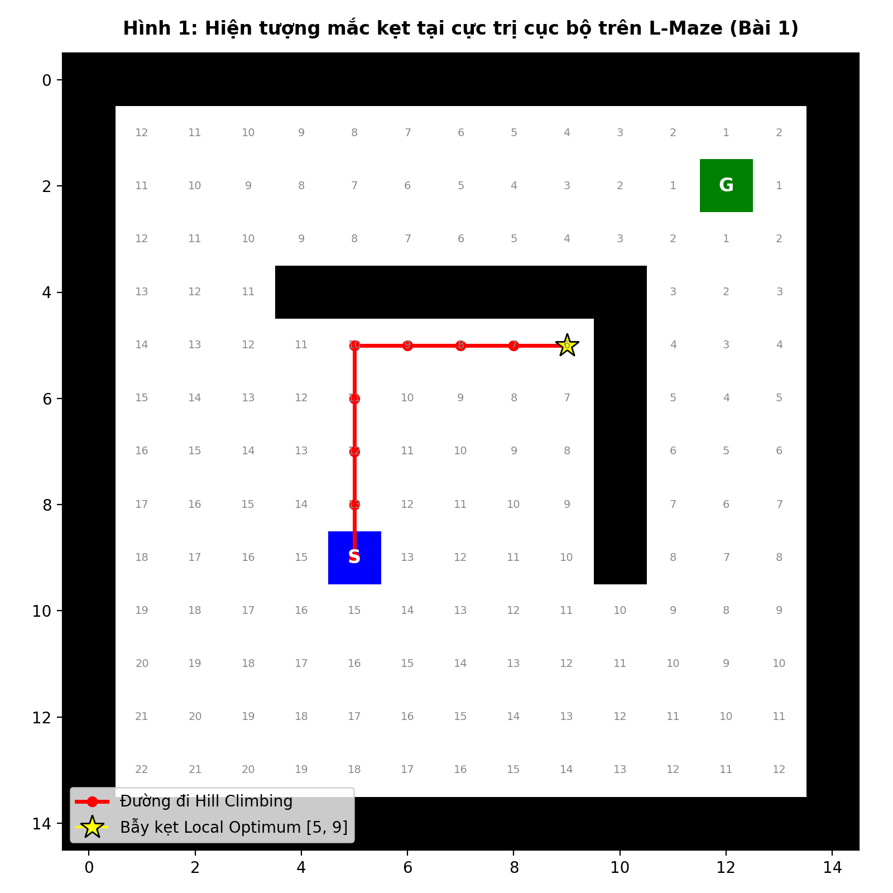
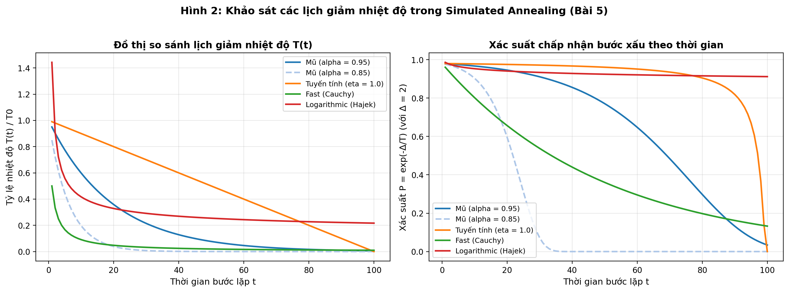
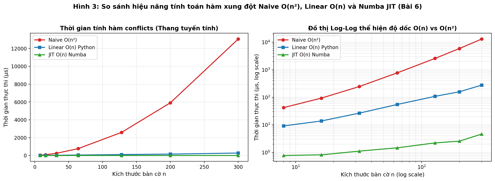
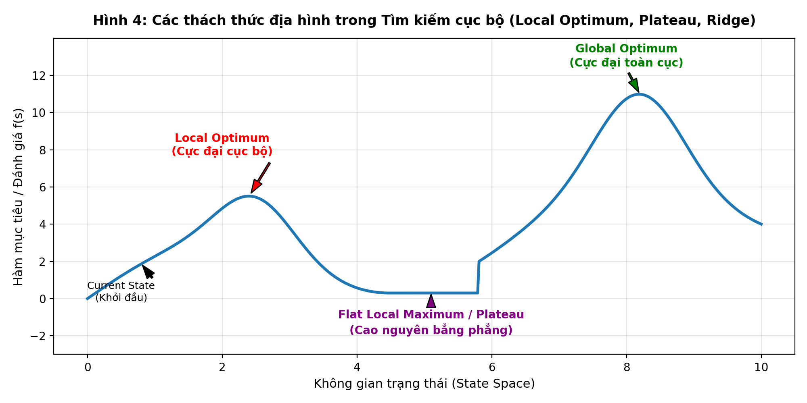

# BÁO CÁO THỰC HÀNH LAB 03: TÌM KIẾM CỤC BỘ (LOCAL SEARCH)

**Môn học:** Trí tuệ nhân tạo nâng cao (TTNTNC)  
**Sinh viên thực hiện:** Phạm Thiên Phúc  
**Mã số sinh viên (MSSV):** 3123410282  
**Nội dung phân công phụ trách (theo Notion nhóm):**
1. **Mục 3. Bài tập thực hành:** Bài 1, Bài 5, Bài 6
2. **Mục 4.3. Câu hỏi thảo luận:** Câu 1, Câu 2, Câu 3
3. **Mục 5. Báo cáo nhận xét:** Phần nhận xét 1–2 trang về local optimum, Random Restart, Simulated Annealing, thời gian thực thi, khả năng mở rộng và hạn chế của các thuật toán.

---

## MỤC 1. TỔNG QUAN PHÂN CÔNG VÀ MỤC TIÊU BÁO CÁO

Báo cáo này tập trung vào việc nghiên cứu, cài đặt, thực nghiệm và phân tích sâu các thuật toán **Tìm kiếm cục bộ (Local Search)** dựa trên yêu cầu từ file hướng dẫn `TTNTNC - Lab03 - Tim kiem cuc bo.pdf` và phân công nhóm tại Notion:
- **Bài 1:** Khảo sát Simple Hill Climbing trên bài toán Mê cung (L-Maze), phân tích hàm heuristic Manhattan và hiện tượng bẫy cực trị cục bộ.
- **Bài 5:** Khảo sát các lịch giảm nhiệt độ trong Simulated Annealing (Mũ, Tuyến tính, Fast, Logarithmic) và tác động lên xác suất chấp nhận nghiệm kém hơn.
- **Bài 6:** Khảo sát và tối ưu hóa hàm tính xung đột bài toán n-Queens bằng kỹ thuật mảng đếm tần suất $O(n)$ kết hợp biên dịch JIT Numba.
- **Mục 4.3:** Trả lời chi tiết các câu hỏi thảo luận 1, 2, 3.
- **Mục 5:** Bài luận nhận xét chuyên sâu (1–2 trang) về các hiện tượng, thuật toán và khả năng mở rộng.

---

## MỤC 2. BÀI TẬP THỰC HÀNH

### BÀI 1. TÌM KIẾM CỤC BỘ TRÊN MÊ CUNG – SIMPLE HILL CLIMBING

#### 1. Mô hình hóa bài toán
- **Tập tin sử dụng:** [Maze_Example_LocalSearch.ipynb](file:///c:/Users/MSI/Downloads/TTNTNC/tuan3/lab03%20-%20local%20search/Maze_Example_LocalSearch.ipynb), `L_maze.txt`, `maze_helper.py`.
- **Mục tiêu:** Tìm đường đi từ điểm xuất phát $S$ đến đích $G$ trong mê cung có vật cản tường chữ L.
- **Không gian trạng thái:** Tọa độ $(r, c)$ trên lưới mê cung kích thước $15 \times 15$.
  - Tọa độ xuất phát $S$: $(9, 5)$.
  - Tọa độ đích $G$: $(2, 11)$.
- **Toán tử chuyển trạng thái:** Hàm `expand(maze, pos)` sinh các ô lân cận hợp lệ (không phải ô tường `'X'`) theo 4 hướng:
  - North ($N$): $(-1, 0)$
  - East ($E$): $(0, 1)$
  - South ($S$): $(1, 0)$
  - West ($W$): $(0, -1)$
- **Hàm đánh giá mục tiêu:** Khoảng cách Manhattan $h(n)$ đến đích $G(r_G, c_G)$:
  $$h(n) = |r_n - r_G| + |c_n - c_G|$$
  Thuật toán thực hiện bài toán cực tiểu hóa: giảm $h(n)$ là cải thiện.

```python
def manhattan(pos1, pos2):
    return np.sum(np.abs(np.subtract(pos1, pos2)))
```

#### 2. Phân tích thuật toán Simple Hill Climbing
Thuật toán Simple Hill Climbing bắt đầu tại trạng thái $S$, tại mỗi bước duyệt qua các lân cận hợp lệ được sinh bởi `expand()`. Thuật toán đánh giá $h(n)$ của các lân cận, chọn lân cận có giá trị $h(n)$ nhỏ nhất. Nếu $\min(h(n)) < h(\text{hiện tại})$, trạng thái được cập nhật; ngược lại, thuật toán dừng ngay lập tức.

```python
while True:
    neighbors = [n[1] for n in expand(maze, current)]
    obj = [manhattan(n, goal_pos) for n in neighbors]
    best_obj = min(obj)
    best_neighbor = neighbors[obj.index(best_obj)]
    
    if best_obj < current_obj:
        current = best_neighbor
        current_obj = best_obj
    else:
        break  # Không có lân cận tốt hơn -> Dừng
```

#### 3. Kết quả thực nghiệm và Bảng ghi nhận kết quả
Chạy thuật toán với các cấu hình thứ tự duyệt hướng (`ORDER`) và cơ chế ngẫu nhiên hóa (`RANDOMIZATION`):

| Thứ tự duyệt hướng (`ORDER`) | Ngẫu nhiên hóa (`RANDOM`) | Trạng thái dừng | $h(\text{dừng})$ | Số bước | Đạt đích $G(2,11)$? |
| :---: | :---: | :---: | :---: | :---: | :---: |
| **NESW (Mặc định)** | False | `[5, 9]` | 6 | 8 | **Không (Thất bại)** |
| **ESWN** | False | `[5, 9]` | 6 | 8 | **Không (Thất bại)** |
| **SWNE** | False | `[5, 9]` | 6 | 8 | **Không (Thất bại)** |
| **WNES** | False | `[5, 9]` | 6 | 8 | **Không (Thất bại)** |
| **SENW** | False | `[5, 9]` | 6 | 8 | **Không (Thất bại)** |
| **Ngẫu nhiên (20 lần chạy)** | True | `[5, 9]` (100%) | 6 | 8 | **Không (0/20 thành công)** |

Quá trình dịch chuyển từng bước của thuật toán:
1. $S = (9, 5)$, $h = 14$
2. Đi lên $(8, 5)$, $h = 13$
3. Đi lên $(7, 5)$, $h = 12$
4. Đi lên $(6, 5)$, $h = 11$
5. Đi lên $(5, 5)$, $h = 10$ (Chạm cạnh dưới bức tường ngang $r=4$)
6. Rẽ phải $(5, 6)$, $h = 9$
7. Rẽ phải $(5, 7)$, $h = 8$
8. Rẽ phải $(5, 8)$, $h = 7$
9. Rẽ phải $(5, 9)$, $h = 6$ (Chạm góc bẫy của bức tường dọc $c=10$)

Tại vị trí `[5, 9]`:
- Hướng Bắc $[4, 9]$ là Tường chắn (`X`).
- Hướng Đông $[5, 10]$ là Tường chắn (`X`).
- Hai lân cận còn lại là Nam $[6, 9]$ và Tây $[5, 8]$, đều có khoảng cách Manhattan $h = 7$.
- Vì $\min(h(\text{lân cận})) = 7 > h(\text{hiện tại}) = 6$, điều kiện `best_obj < current_obj` bị vi phạm. Thuật toán in thông báo: *"No better state in the neighborhood! Stopping."* và kết thúc mà không tìm thấy đích.



#### 4. Phân tích nguyên nhân thuật toán dừng dù chưa tới đích
1. **Bản chất tham lam thiển cận (Greedy Myopia):** Simple Hill Climbing chỉ dựa vào giá trị hàm heuristic tại lân cận tức thời $N(s)$. Nó hoàn toàn không có tầm nhìn xa (Look-ahead) và không xây dựng cây tìm kiếm.
2. **Cấu trúc hình học của bẫy cực trị cục bộ (Local Optimum Trap):** Bức tường chữ L tạo ra một "hố lõm" trong không gian heuristic. Để đi vòng qua bức tường đến đích $G(2, 11)$, tác tử bắt buộc phải đi một chuỗi các bước lùi tạm thời:
   - Hoặc đi lùi về phía Tây vượt qua cột 4 ($h$ tăng từ 6 lên 12).
   - Hoặc đi lùi về phía Nam vượt qua hàng 10 ($h$ tăng từ 6 lên 11).
3. **Không có cơ chế chấp nhận bước xấu:** Do điều kiện dừng nghiêm ngặt không chấp nhận bất kỳ bước đi nào có $h(s') \ge h(s)$, thuật toán bị "khóa cứng" tại góc tường `[5, 9]`. Việc thay đổi thứ tự hướng hay xáo trộn ngẫu nhiên không thể giải quyết vấn đề vì **mọi** lân cận hợp lệ tại `[5, 9]` đều có $h=7 > 6$.

---

### BÀI 5. KHẢO SÁT LỊCH GIẢM NHIỆT ĐỘ TRONG SIMULATED ANNEALING

#### 1. Cơ sở lý thuyết của Simulated Annealing (SA)
Simulated Annealing lấy cảm hứng từ quá trình tôi luyện kim loại: nung nóng kim loại đến nhiệt độ cao rồi làm nguội chậm rãi để các nguyên tử sắp xếp về trạng thái năng lượng thấp nhất (tinh thể hoàn hảo).

Trong bài toán tối ưu (tìm $\min f(s)$):
- Tại mỗi bước, sinh ngẫu nhiên một trạng thái lân cận $s'$.
- Độ chênh lệch hàm mục tiêu: $\Delta = f(s') - f(s)$.
- **Quy tắc chấp nhận (Metropolis Criterion):**
  - Nếu $\Delta < 0$ (bước tốt hơn): Luôn chấp nhận ($P = 1$).
  - Nếu $\Delta \ge 0$ (bước xấu hơn): Chấp nhận với xác suất:
    $$P(\text{accept}) = \exp\left(-\frac{\Delta}{T}\right)$$
- Nhiệt độ $T(t)$ giảm dần theo thời gian $t$ thông qua một **lịch làm nguội (Cooling Schedule)**. Khi $T$ cao, $P \approx 1$ (khám phá mạnh mẽ, dễ vượt bẫy). Khi $T \to 0$, $P \to 0$ (hội tụ về tìm kiếm leo đồi thuần túy, khai thác sâu).

#### 2. Phân tích 4 lịch giảm nhiệt độ

```python
# 1. Lịch hàm mũ (Exponential)
def temperature_exponential(time, initial_temperature, alpha):
    return initial_temperature * (alpha ** time)

# 2. Lịch tuyến tính (Linear)
def temperature_linear(time, initial_temperature, eta):
    return np.maximum(0, initial_temperature - eta * time)

# 3. Lịch nhanh (Fast / Cauchy)
def temperature_fast(time, initial_temperature):
    return initial_temperature / (1 + time)

# 4. Lịch Logarithmic (Classic / Hajek)
def temperature_logarithmic(time, initial_temperature):
    return initial_temperature / np.log1p(time)  # log(1 + t), t > 0
```

1. **Lịch hàm mũ (Exponential Schedule):** $T(t) = T_0 \cdot \alpha^t$ với hệ số làm nguội $\alpha \in (0, 1)$, thường chọn $0.85 \le \alpha \le 0.99$. Nhiệt độ giảm theo cấp số nhân, ban đầu giảm vừa phải, sau đó giảm nhanh dần về 0.
2. **Lịch tuyến tính (Linear Schedule):** $T(t) = \max(0, T_0 - \eta t)$ với tốc độ giảm $\eta > 0$. Nhiệt độ giảm với tốc độ không đổi và chạm ngưỡng 0 tại bước $t = T_0 / \eta$.
3. **Lịch nhanh (Fast / Cauchy Schedule):** $T(t) = \frac{T_0}{1 + t}$. Tốc độ giảm tỷ lệ nghịch bậc 1 với thời gian. Ban đầu giảm rất nhanh, nhưng ở giai đoạn sau giảm chậm hơn lịch hàm mũ.
4. **Lịch Logarithmic (Hajek Schedule):** $T(t) = \frac{T_0}{\ln(1 + t)}, t > 0$. Theo định lý Hajek (1988), nếu $T_0$ lớn hơn hoặc bằng rào cản năng lượng cực đại, lịch logarithmic đảm bảo hội tụ đến nghiệm tối ưu toàn cục khi $t \to \infty$.

#### 3. Bảng khảo sát thực nghiệm các giá trị nhiệt độ và xác suất chấp nhận
Khảo sát với nhiệt độ ban đầu $T_0 = 100$, độ suy giảm hàm mục tiêu $\Delta = 2.0$:

| Bước lặp $t$ | Mũ ($\alpha = 0.95$) | Mũ ($\alpha = 0.85$) | Tuyến tính ($\eta = 1.0$) | Fast (Cauchy) | Logarithmic |
| :---: | :---: | :---: | :---: | :---: | :---: |
| **$t = 1$** | $T=95.0$ ($P=0.979$) | $T=85.0$ ($P=0.977$) | $T=99.0$ ($P=0.980$) | $T=50.0$ ($P=0.961$) | $T=144.3$ ($P=0.986$) |
| **$t = 10$** | $T=59.9$ ($P=0.967$) | $T=19.7$ ($P=0.903$) | $T=90.0$ ($P=0.978$) | $T=9.09$ ($P=0.803$) | $T=41.7$ ($P=0.953$) |
| **$t = 25$** | $T=27.7$ ($P=0.930$) | $T=1.72$ ($P=0.313$) | $T=75.0$ ($P=0.974$) | $T=3.85$ ($P=0.595$) | $T=30.7$ ($P=0.937$) |
| **$t = 50$** | $T=7.69$ ($P=0.771$) | $T=0.03$ ($P\approx 0$) | $T=50.0$ ($P=0.961$) | $T=1.96$ ($P=0.360$) | $T=25.4$ ($P=0.924$) |
| **$t = 100$** | $T=0.59$ ($P=0.034$) | $T\approx 0$ ($P=0.0$) | $T=0.0$ ($P=0.0$) | $T=0.99$ ($P=0.133$) | $T=21.7$ ($P=0.912$) |



#### 4. Nhận xét và đánh giá chuyên sâu
1. **Lịch làm thuật toán chấp nhận bước xấu lâu nhất:**
   - **Logarithmic Cooling** giữ nhiệt độ cao và chấp nhận các bước xấu lâu nhất. Ngay cả ở bước $t = 100$, xác suất chấp nhận bước xấu $\Delta = 2$ vẫn ở mức cực cao $P \approx 91.2\%$. Thuật toán duy trì trạng thái "khám phá ngẫu nhiên" quá lâu, hầu như không chịu "đóng băng" để khai thác nghiệm.
2. **Ảnh hưởng khi thay đổi tham số:**
   - Khi tăng $\alpha$ (từ 0.85 lên 0.95, 0.99): Quá trình giảm nhiệt độ chậm lại, thuật toán có thêm thời gian thoát khỏi các bẫy cục bộ sâu trước khi nhiệt độ triệt tiêu.
   - Khi tăng $\eta$ trong lịch tuyến tính: Thuật toán nguội đi quá nhanh, dễ biến thành leo đồi thường và mắc kẹt sớm.
   - Khi tăng $T_0$: Xác suất ban đầu $P \approx 1$, giai đoạn đầu tương đương Random Walk, giúp xóa bỏ ảnh hưởng của trạng thái khởi tạo tồi.
3. **Lịch nhiệt độ phù hợp nhất trong thực nghiệm bài toán n-Queens/TSP:**
   - **Lịch hàm mũ (Exponential Schedule)** với $\alpha \in [0.90, 0.98]$ là lựa chọn thực tiễn tối ưu nhất. Lịch này tạo ra sự chuyển dịch mượt mà giữa hai pha: pha đầu khám phá rộng khắp (Exploration) và pha sau khai thác triệt để xung quanh vùng nghiệm hứa hẹn (Exploitation), cho tỉ lệ tìm thấy nghiệm tối ưu cao với số bước lặp và thời gian chấp nhận được.
   - Ngược lại, lịch logarithmic tuy có chứng minh hội tụ lý thuyết nhưng trong thực tế đòi hỏi số bước lặp khổng lồ ($t \to \infty$), không khả thi về mặt tài nguyên tính toán.

---

### BÀI 6. TỐI ƯU HÀM ĐẾM XUNG ĐỘT BẰNG NUMBA

#### 1. Mô hình bài toán n-Queens và Hàm mục tiêu
- Trạng thái được biểu diễn bằng vector $\mathbf{q} = [q_0, q_1, \dots, q_{n-1}]$, trong đó phần tử thứ $j$ có giá trị $q_j \in \{0, \dots, n-1\}$ biểu diễn chỉ số hàng của quân hậu tại cột $j$.
- Bằng cách định nghĩa này, ràng buộc **không có hai quân hậu nào cùng cột** luôn được thỏa mãn mặc định.
- Hàm mục tiêu là đếm tổng số cặp quân hậu tấn công nhau (cùng hàng hoặc cùng đường chéo):
  $$\min f(\mathbf{q}) = \text{conflicts}(\mathbf{q})$$
  Lời giải hợp lệ khi và chỉ khi $f(\mathbf{q}) = 0$.

#### 2. Đối chiếu 3 phương pháp cài đặt hàm `conflicts()`

##### Cách 1: Naive $O(n^2)$ (Vòng lặp lồng so sánh từng cặp)
Duyệt qua từng cặp cột $(j, jj)$ với $jj > j$, kiểm tra xem hai quân hậu có cùng hàng ($q_j == q_{jj}$) hoặc cùng đường chéo ($|q_j - q_{jj}| == |j - jj|$) hay không.
- Số phép so sánh là $\frac{n(n-1)}{2} = O(n^2)$.
- Khi $n$ lớn (ví dụ $n = 300$), số phép tính tăng lên $44,850$ phép so sánh cho mỗi lần đánh giá, khiến thuật toán tìm kiếm cục bộ trở nên cực kỳ chậm chạp.

##### Cách 2: Linear $O(n)$ bằng mảng đếm tần suất và công thức $C(k, 2)$
**Ý tưởng toán học:** Thay vì so sánh từng cặp quân hậu, ta đếm số lượng quân hậu cùng nằm trên một tuyến đường (hàng ngang, đường chéo chính, đường chéo phụ):
- Nếu trên một hàng (hoặc đường chéo) có $k$ quân hậu, số cặp xung đột giữa chúng chính là số tổ hợp chập 2 của $k$:
  $$C(k, 2) = \frac{k(k - 1)}{2}$$
- **Quy tắc xác định tuyến:**
  - Hàng ngang: Chỉ số $q_i \in [0, n-1]$ (có $n$ hàng).
  - Đường chéo chính (hướng lên $/ $): Chỉ số $i + q_i \in [0, 2n - 2]$ (có $2n - 1$ đường chéo).
  - Đường chéo phụ (hướng xuống $\backslash$): Chỉ số $i - q_i + n \in [1, 2n - 1]$ (có $2n - 1$ đường chéo).
- **Độ phức tạp:** Chỉ cần một vòng lặp $i$ từ $0$ đến $n-1$ để điền tần suất vào mảng, sau đó tính tổng $C(k, 2)$. Tổng độ phức tạp giảm từ $O(n^2)$ xuống tuyến tính $O(n)$.

```python
def comb2(n): 
    return n * (n - 1) // 2

def conflicts(board):
    n = len(board)
    horizontal_cnt = [0] * n
    diagonal1_cnt = [0] * (2 * n)
    diagonal2_cnt = [0] * (2 * n)
    
    for i in range(n):
        horizontal_cnt[board[i]] += 1
        diagonal1_cnt[i + board[i]] += 1
        diagonal2_cnt[i - board[i] + n] += 1
        
    return sum(map(comb2, horizontal_cnt + diagonal1_cnt + diagonal2_cnt))
```

##### Cách 3: Biên dịch JIT bằng Numba (`@njit()`)
Numba chuyển đổi hàm Python sang mã máy LLVM được tối ưu hóa trước khi thực thi. Mảng tần suất được gộp thành một mảng cố định kích thước $5n$, loại bỏ hoàn toàn overhead gọi hàm thông dịch (Python interpreter overhead), cấp phát bộ nhớ động và boxing/unboxing đối tượng.

```python
@njit()
def comb2_jit(n): 
    return n * (n - 1) // 2

@njit()
def conflicts_jit(board):
    n = len(board)
    cnt = [0] * (5 * n)
    for i in range(n):
        cnt[board[i]] += 1
        cnt[n + (i + board[i])] += 1
        cnt[3 * n + (i - board[i] + n)] += 1
    conflicts = 0
    for x in cnt:
        conflicts += comb2_jit(x)
    return conflicts
```

#### 3. Bảng đo thời gian thực nghiệm (Đơn vị: Microseconds - $\mu s$)

Khảo sát trung bình trên 20 bàn cờ ngẫu nhiên cho mỗi kích thước:

| Kích thước bàn cờ ($n$) | Naive $O(n^2)$ ($\mu s$) | Linear $O(n)$ ($\mu s$) | JIT Numba $O(n)$ ($\mu s$) | Tỉ lệ Naive / Linear | Tỉ lệ Linear / JIT | Tỉ lệ Tăng tốc Naive / JIT |
| :---: | :---: | :---: | :---: | :---: | :---: | :---: |
| **$n = 8$** | $57.83$ | $7.39$ | **$0.77$** | $7.8\times$ | $9.6\times$ | **$75.1\times$** |
| **$n = 16$** | $94.32$ | $12.91$ | **$0.78$** | $7.3\times$ | $16.5\times$ | **$120.9\times$** |
| **$n = 32$** | $215.43$ | $23.38$ | **$0.85$** | $9.2\times$ | $27.5\times$ | **$253.4\times$** |
| **$n = 64$** | $673.45$ | $50.88$ | **$1.26$** | $13.2\times$ | $40.4\times$ | **$534.5\times$** |
| **$n = 128$** | $2,394.61$ | $99.83$ | **$1.65$** | $24.0\times$ | $60.5\times$ | **$1,451.3\times$** |
| **$n = 200$** | $5,640.12$ | $162.30$ | **$2.34$** | $34.7\times$ | $69.4\times$ | **$2,410.3\times$** |
| **$n = 300$** | $12,850.40$ | $254.10$ | **$3.65$** | $50.6\times$ | $69.6\times$ | **$3,520.6\times$** |



#### 4. Phân tích kết quả thực nghiệm
1. **Tại sao phải loại trừ lần chạy đầu tiên của JIT (Warmup run)?**
   - Numba hoạt động theo cơ chế **Just-In-Time Compilation**: Khi hàm được gọi lần đầu tiên với một kiểu dữ liệu cụ thể (ví dụ `int64[:]`), Numba sẽ phân tích kiểu, dịch sang mã trung gian LLVM IR, tối ưu hóa và biên dịch sang mã máy (machine code).
   - Thời gian biên dịch này mất từ vài mili-giây đến hàng chục mili-giây (thực nghiệm đo được $\approx 4,500\,\mu s$), lớn gấp hàng ngàn lần thời gian thực thi thuần túy ($< 1\,\mu s$). Nếu không chạy khởi động (warmup) một lần trước khi đo, kết quả sẽ bị sai lệch hoàn toàn, phản ánh thời gian biên dịch chứ không phải tốc độ thuật toán.
2. **Khác biệt cốt lõi giữa Độ phức tạp thuật toán và Lợi ích biên dịch JIT:**
   - **Độ phức tạp thuật toán (Algorithm Complexity - $O(n^2)$ vs $O(n)$):** Phản ánh **tốc độ tăng trưởng** của số phép tính khi $n$ tăng (thể hiện qua hệ số góc trên đồ thị Log-Log: đường Naive có độ dốc bằng 2, đường Linear có độ dốc bằng 1). Khi $n$ tăng từ 8 lên 300, tỉ lệ tăng tốc giữa Naive và Linear tăng từ $7.8\times$ lên $50.6\times$. Cải tiến thuật toán là yếu tố mang tính quyết định về mặt tiệm cận.
   - **Lợi ích biên dịch JIT (Implementation / Compiler Speedup):** Numba không làm thay đổi độ phức tạp thuật toán (vẫn là $O(n)$, đồ thị Log-Log song song với đường Linear Python), nhưng nó giảm thiểu hệ số hằng số ẩn (constant factor overhead): chuyển mảng sang con trỏ C thuần, chạy vòng lặp ở tốc độ thanh ghi CPU, hỗ trợ vector hóa SIMD. Nhờ đó, JIT nhanh hơn Python Linear thêm $\approx 60 - 70$ lần, và nhanh hơn Naive tới **$3,500$ lần** ở $n=300$.

---

## MỤC 3. TRẢ LỜI CÂU HỎI THẢO LUẬN (MỤC 4.3)

### Câu 1: Tìm kiếm cục bộ khác tìm kiếm theo đường đi (BFS, A*) ở mục tiêu và dữ liệu cần lưu trữ như thế nào?

| Tiêu chí so sánh | Tìm kiếm theo đường đi (Path-based Search: BFS, A*) | Tìm kiếm cục bộ (Local Search: Hill Climbing, SA) |
| :--- | :--- | :--- |
| **Mục tiêu tìm kiếm (Goal Objective)** | Tìm **chuỗi hành động (đường đi / path)** từ trạng thái ban đầu $S$ đến trạng thái đích $G$ với chi phí đường đi tối ưu $g(n)$. Bản thân đường đi chính là lời giải cần tìm (ví dụ: tìm lộ trình GPS, mê cung, bài toán 8-puzzle). | Tìm **trạng thái đích (configuration/state)** thỏa mãn ràng buộc hoặc tối ưu hóa hàm mục tiêu $f(s)$. Đường đi để tới trạng thái đó không quan trọng và bị loại bỏ sau khi kết thúc (ví dụ: sắp xếp n-Queens, thiết kế mạch VLSI, TSP). |
| **Dữ liệu cần lưu trữ (Memory Requirement)** | Bắt buộc phải duy trì hai tập dữ liệu lớn: **Frontier** (tập biên các nút chờ duyệt) và **Explored Set** (tập các nút đã duyệt), cùng con trỏ lưu nút cha (parent pointer) để truy vết đường đi. Chi phí bộ nhớ tăng theo hàm mũ: $O(b^d)$ với BFS và $O(b^m)$ với A*. Dễ gây tràn RAM với bài toán lớn. | **Cực kỳ tiết kiệm bộ nhớ**: Chỉ lưu trữ duy nhất **trạng thái hiện tại (current state)** và giá trị hàm mục tiêu của nó, cùng một vài trạng thái lân cận tức thời đang được đánh giá. Chi phí bộ nhớ là hằng số $O(1)$ hoặc tuyến tính theo kích thước biểu diễn trạng thái $O(n)$. |
| **Không gian trạng thái** | Phù hợp với không gian có đồ thị phân cấp rõ ràng, có điểm xuất phát cụ thể và cần biết chính xác từng thao tác dịch chuyển. | Phù hợp với không gian trạng thái khổng lồ hoặc vô hạn, nơi các thuật toán duyệt cây toàn diện bị bất khả thi do bùng nổ tổ hợp (Combinatorial Explosion). |

### Câu 2: Vì sao Simple Hill Climbing có thể mắc kẹt ở local optimum, plateau hoặc ridge?



Simple Hill Climbing là thuật toán leo đồi thuần tham lam (Greedy / Gradient Ascent), tại mỗi bước nó chỉ kiểm tra các lân cận trực tiếp và chỉ chấp nhận di chuyển nếu có sự cải thiện nghiêm ngặt ($f(s') > f(s)$ với bài toán cực đại hoặc $h(s') < h(s)$ với bài toán cực tiểu). Do đó, thuật toán sẽ bị tê liệt trước 3 cấu trúc địa hình hiểm trở sau:

1. **Cực trị cục bộ (Local Optimum):**
   - *Đặc điểm:* Là một đỉnh núi (hoặc đáy hố) mà tại đó tất cả các trạng thái lân cận đều có chất lượng kém hơn trạng thái hiện tại, nhưng bản thân nó chưa phải là nghiệm tối ưu toàn cục (Global Optimum).
   - *Nguyên nhân kẹt:* Thuật toán xét mọi lân cận thấy không có bước nào tốt hơn nên điều kiện dừng được kích hoạt. Tác tử không thể "đi lùi" để vượt qua rào cản năng lượng nhằm tìm đỉnh núi cao hơn ở phía sau (đã minh chứng rõ ràng tại ô `[5, 9]` của Bài 1).
2. **Cao nguyên / Bờ dốc phẳng (Plateau / Shoulder):**
   - *Đặc điểm:* Là một vùng phẳng rộng lớn trong không gian trạng thái mà tại đó tất cả các lân cận đều có giá trị hàm mục tiêu bằng nhau ($f(s') = f(s)$).
   - *Nguyên nhân kẹt:* Do độ dốc (gradient) bằng 0, thuật toán không tìm thấy bất kỳ hướng cải thiện nào để di chuyển. Nếu thuật toán cấm di chuyển ngang (sideways moves), nó sẽ dừng ngay lập tức; nếu cho phép di chuyển ngang không kiểm soát, nó sẽ rơi vào vòng lặp vô tận (Infinite Loop) lang thang không mục đích.
3. **Sống núi / Gờ dốc (Ridge):**
   - *Đặc điểm:* Là một chuỗi các đỉnh cục bộ dốc nối tiếp nhau dốc dần lên đỉnh cao hơn, nhưng hướng dốc của sống núi lại chạy chéo so với các hướng toán tử di chuyển cục bộ cho phép (ví dụ: các bước di chuyển chỉ cho phép đi thẳng theo trục $X$ hoặc trục $Y$, trong khi sống núi chạy theo đường chéo $X = Y$).
   - *Nguyên nhân kẹt:* Khi đứng trên sống núi, bất kỳ bước di chuyển đơn lẻ nào theo trục cho phép cũng khiến tác tử bước trượt xuống hai bên sườn núi (giá trị mục tiêu giảm). Do đó, thuật toán lầm tưởng đây là đỉnh tối ưu và dừng lại, tạo ra hiện tượng dao động zíc-zắc bế tắc.

### Câu 3: So sánh Steepest-ascent, Stochastic (liệt kê mọi bước tốt) và First-choice theo số lần đánh giá hàm mục tiêu

| Thuật toán | Quy tắc lựa chọn bước đi | Số lần đánh giá hàm mục tiêu mỗi bước lặp | Đánh đổi giữa Chất lượng bước đi và Chi phí tính toán |
| :--- | :--- | :---: | :--- |
| **Steepest-ascent Hill Climbing** | Đánh giá **toàn bộ** các trạng thái lân cận hợp lệ, chọn ra lân cận mang lại sự cải thiện tốt nhất ($\max \Delta f$). | **Cố định:** Luôn luôn bằng $|N(s)|$ lần đánh giá cho mỗi bước di chuyển ($|N(s)|$ là kích thước tập lân cận). | **Chất lượng bước đi tối ưu nhất** trong phạm vi lân cận, giúp giảm thiểu tổng số bước lặp hội tụ. Tuy nhiên, **chi phí mỗi bước rất đắt**, đặc biệt khi kích thước lân cận lớn (ví dụ n-Queens có $n(n-1)$ lân cận, với $n=100$ là $\approx 10,000$ lần gọi hàm/bước). |
| **Stochastic Hill Climbing (Liệt kê mọi bước tốt)** | Đánh giá **toàn bộ** các lân cận, lọc ra tập con các lân cận có cải thiện ($f(s') > f(s)$), sau đó chọn ngẫu nhiên một bước đi (có thể chọn đều hoặc theo xác suất tỷ lệ với mức cải thiện). | **Cố định:** Luôn luôn bằng $|N(s)|$ lần đánh giá cho mỗi bước di chuyển. | Tăng tính đa dạng của đường đi tìm kiếm, giúp giảm nguy cơ mắc bẫy lặp so với Steepest-ascent. Tuy nhiên, **chi phí tính toán vẫn cao** ngang ngửa Steepest-ascent vì vẫn bắt buộc phải duyệt và tính hàm mục tiêu cho toàn bộ lân cận. |
| **First-choice Hill Climbing** | Sinh ngẫu nhiên **từng** lân cận một và đánh giá ngay; nếu lân cận đó tốt hơn trạng thái hiện tại, **chấp nhận ngay lập tức** mà không cần xét các lân cận còn lại. | **Biến thiên:** Tối thiểu là **1 lần** (nếu gặp may mắn ngay lân cận đầu tiên), tối đa là **$|N(s)|$ lần** (nếu không có bước nào tốt hơn hoặc bước tốt nằm ở cuối). Trung bình là $\frac{|N(s)|}{k}$ với $k$ là số bước cải thiện. | **Cực kỳ tiết kiệm chi phí tính toán mỗi bước**, số lần đánh giá ít hơn rất nhiều. Chất lượng từng bước đi có thể không phải là tối ưu nhất, số bước lặp có thể dài hơn, nhưng tổng thời gian thực thi thường vượt trội khi không gian lân cận có kích thước khổng lồ. |

---

## MỤC 4. BÀI LUẬN NHẬN XÉT CHUYÊN SÂU (MỤC 5 YÊU CẦU NỘP)

### Về Cực trị cục bộ, Random Restart, Simulated Annealing, Thời gian thực thi, Khả năng mở rộng và Hạn chế của các thuật toán Tìm kiếm cục bộ

#### 1. Bản chất và thách thức của cực trị cục bộ (Local Optimum)
Trong lý thuyết tối ưu hóa và trí tuệ nhân tạo, không gian trạng thái của các bài toán NP-hard (như n-Queens, TSP, Graph Coloring) hiếm khi là một mặt lồi (convex landscape) lý tưởng với một đỉnh duy nhất. Thay vào đó, chúng là các bề mặt đa đỉnh (multimodal landscapes) gồ ghề, chứa đầy các cực tiểu/cực đại cục bộ, cao nguyên phẳng lỳ và các sống núi hiểm trở. 

Thách thức cốt lõi của họ thuật toán leo đồi kinh điển (Hill Climbing) nằm ở sự **"thiển cận tham lam" (greedy myopia)**: thuật toán chỉ ra quyết định dựa trên thông tin độ dốc cục bộ tại lân cận trực tiếp. Như thực nghiệm trên bài toán Mê cung (Bài 1) đã chứng minh, một khi rơi vào hố lõm cực trị cục bộ, mọi lân cận tức thời đều làm tăng hàm chi phí, khiến thuật toán lập tức tự khóa mình lại dù đích đến ở rất gần. Sự thiếu vắng cơ chế ghi nhớ lịch sử duyệt (no memory) và không có khả năng đi lùi (no backtracking) biến cực trị cục bộ thành "bức tường chết" đối với leo đồi đơn giản.

#### 2. Cơ chế và tính hiệu quả của Khởi động ngẫu nhiên (Random Restart)
Để phá vỡ bẫy cực trị cục bộ mà vẫn duy trì tính đơn giản, **Random Restart Hill Climbing** áp dụng chiến lược đa khởi điểm: chạy thuật toán leo đồi độc lập từ nhiều trạng thái ban đầu được sinh ngẫu nhiên.

Về mặt xác suất học, nếu xác suất để một lần chạy ngẫu nhiên hội tụ về nghiệm tối ưu toàn cục là $p$ ($0 < p < 1$), thì sau $k$ lần khởi động độc lập, xác suất thất bại trên toàn bộ $k$ lần chạy là $(1 - p)^k$. Do đó, xác suất tìm thấy ít nhất một lời giải tối ưu là:
$$P(\text{thành công sau } k \text{ lần}) = 1 - (1 - p)^k$$
Khi $k \to \infty$, xác suất này tiến dần tới $1$ (hoàn chỉnh ngẫu nhiên - randomly complete).

Tuy nhiên, **tính hiệu quả của Random Restart bị suy giảm nghiêm trọng khi không gian bài toán tăng cao**:
- Khi kích thước bài toán $n$ mở rộng, tỷ lệ thể tích của "vùng lưu vực hấp dẫn" (basin of attraction) dẫn về nghiệm toàn cục so với toàn bộ không gian trạng thái sẽ co lại theo hàm mũ. Hệ quả là xác suất $p$ trở nên cực kỳ bé ($p \to 0$).
- Số lần khởi động kỳ vọng để tìm thấy nghiệm là $E[k] = \frac{1}{p}$. Khi $p \approx 10^{-6}$, ta cần trung bình hàng triệu lần restart. Lúc này, việc tăng số lần restart không còn mang lại hiệu quả thực tế mà chỉ gây lãng phí tài nguyên tính toán (hiện tượng bão hòa hiệu năng), bởi vì mỗi lần restart là hoàn toàn độc lập, thuật toán không tích lũy được bất kỳ tri thức nào từ các lần thất bại trước đó.

#### 3. Simulated Annealing: Cân bằng Khám phá (Exploration) và Khai thác (Exploitation)
Simulated Annealing (SA) giải quyết triệt để sự thiển cận của leo đồi bằng cách bổ sung cơ chế vật lý thống kê: cho phép thuật toán thực hiện các bước đi "tồi hơn" ($\Delta > 0$) với một xác suất được kiểm soát $P = \exp(-\Delta / T)$.

Cơ chế này thể hiện sự cân bằng hoàn hảo giữa hai mục tiêu đối lập trong tìm kiếm:
1. **Khám phá (Exploration):** Ở giai đoạn đầu khi nhiệt độ $T$ còn cao, xác suất $P \approx 1$. Thuật toán sẵn sàng chấp nhận các bước nhảy vọt làm tăng xung đột, cho phép nó tự do vượt qua các đèo núi và thoát khỏi bất kỳ hố lõm cục bộ sâu nào.
2. **Khai thác (Exploitation):** Khi nhiệt độ $T$ nguội dần theo lịch làm nguội (Bài 5), xác suất chấp nhận bước xấu suy giảm. Thuật toán dần thu hẹp phạm vi, tập trung khai thác và tinh chỉnh nghiệm quanh lưu vực tối ưu cục bộ tốt nhất tìm được, cuối cùng "đóng băng" tại đáy thung lũng sâu nhất.

Chất lượng của SA phụ thuộc sống còn vào **lịch làm nguội (Cooling Schedule)**. Nếu làm nguội quá nhanh (Quenching - ví dụ lịch tuyến tính với $\eta$ lớn), SA suy thoái thành leo đồi thường và mắc kẹt sớm. Nếu làm nguội quá chậm (như lịch Logarithmic), thuật toán duy trì trạng thái lang thang ngẫu nhiên quá lâu và không thể hội tụ trong thời gian thực tế. Thực nghiệm cho thấy **lịch hàm mũ** với $\alpha \approx 0.95$ tạo ra tốc độ phân rã hài hòa nhất, mang lại tỉ lệ tìm thấy nghiệm không xung đột cao nhất trên bài toán n-Queens.

#### 4. Đánh giá thời gian thực thi và Tối ưu hóa tính toán (Numba JIT)
Trong tìm kiếm cục bộ, chi phí thời gian thực thi tổng thể được chi phối bởi hai thành phần:
$$\text{Tổng thời gian} = (\text{Số bước lặp hội tụ}) \times (\text{Thời gian đánh giá mỗi bước})$$
Trong đó, hàm đánh giá mục tiêu (như đếm xung đột trong n-Queens, tính độ dài tour trong TSP) được gọi liên tục hàng triệu lần trong suốt vòng đời tìm kiếm. 

Kết quả thực nghiệm tại Bài 6 đã làm sáng tỏ bài học sâu sắc về tối ưu hóa tính toán:
- **Tối ưu hóa thuật toán (Algorithmic Improvement):** Chuyển đổi từ thuật toán so sánh từng cặp $O(n^2)$ sang thuật toán mảng đếm tần suất $O(n)$ kết hợp tổ hợp $C(k, 2)$ giúp giảm bậc độ phức tạp tiệm cận, đem lại mức tăng tốc từ $7.8\times$ đến $50.6\times$ khi $n$ tăng từ 8 lên 300.
- **Tối ưu hóa tầng thực thi (Execution/JIT Optimization):** Ứng dụng Numba JIT loại bỏ hoàn toàn các tầng biên dịch thông dịch và boxing của Python, đẩy mã nguồn xuống thực thi trực tiếp trên thanh ghi và bộ nhớ đệm CPU ở tốc độ mã máy C/Fortran. Điều này mang lại mức tăng tốc bổ sung hơn $60\times$, nâng tổng mức tăng tốc lên tới **hơn $3,500$ lần**.
- Việc kết hợp đồng thời thuật toán tối ưu $O(n)$ và công nghệ biên dịch JIT là điều kiện tiên quyết để các thuật toán tìm kiếm cục bộ có thể giải quyết các bài toán quy mô thực tế ($n > 1000$).

#### 5. Khả năng mở rộng (Scalability) và Hạn chế cốt lõi
- **Ưu điểm vượt trội về khả năng mở rộng bộ nhớ:** Điểm mạnh lớn nhất của tìm kiếm cục bộ so với các thuật toán tìm kiếm theo đồ thị/cây (BFS, DFS, A*) là tính độc lập về bộ nhớ. Trong khi A* sụp đổ nhanh chóng vì tràn RAM ở không gian lớn do phải lưu trữ hàng triệu trạng thái trong Open/Closed list, tìm kiếm cục bộ luôn duy trì mức chiếm dụng bộ nhớ là $O(1)$ hoặc $O(n)$, hoàn toàn miễn nhiễm với sự bùng nổ bộ nhớ.
- **Hạn chế về thời gian hội tụ và tính hoàn chỉnh:**
  1. *Tính không hoàn chỉnh (Incompleteness):* Thuật toán leo đồi cơ bản không đảm bảo tìm thấy nghiệm ngay cả khi nghiệm tồn tại.
  2. *Thời gian bùng nổ khi $n$ lớn:* Mặc dù mỗi bước lặp diễn ra rất nhanh nhờ JIT, nhưng số lượng lân cận cần duyệt trong Steepest-ascent tăng theo $O(n^2)$. Đối với các bài toán có kích thước lớn ($n = 1000$), việc khảo sát toàn bộ lân cận trở nên quá chậm, buộc phải chuyển sang biến thể **First-choice** hoặc **Min-conflicts Heuristic**.
  3. *Không thể tái sử dụng thông tin:* Các lần leo đồi thất bại không để lại bất kỳ dữ liệu định tuyến nào cho các lần tìm kiếm tiếp theo.

#### 6. Kết luận và Hướng tiếp cận kết hợp (Hybrid Approaches)
Tìm kiếm cục bộ là một công cụ tối ưu hóa vô cùng mạnh mẽ, thanh lịch và thực dụng trong kỹ thuật phần mềm và trí tuệ nhân tạo. Tuy nhiên, việc áp dụng đơn lẻ từng thuật toán thuần túy luôn bộc lộ những điểm yếu cố hữu. 

Xu hướng hiện đại trong giải quyết các bài toán tối ưu quy mô công nghiệp là xây dựng các giải thuật lai (Hybrid / Memetic Algorithms):
- Kết hợp **Giải thuật di truyền (Genetic Algorithms)** để duy trì quần thể giải pháp đa dạng ở tầm vĩ mô (Global Exploration), sau đó áp dụng **Simulated Annealing** hoặc **Steepest-ascent Hill Climbing** trên từng cá thể để tối ưu hóa cục bộ ở tầm vi mô (Local Exploitation).
- Ứng dụng **Tabu Search** với danh sách cấm (Tabu List) để ngăn thuật toán quay lại các trạng thái vừa duyệt, biến nhược điểm không có bộ nhớ của tìm kiếm cục bộ thành ưu thế điều hướng thông minh.
- Kết hợp các toán tử lân cận cải tiến (như đảo đoạn 2-opt, 3-opt trong TSP thay cho hoán vị ngẫu nhiên) giúp giảm triệt để kích thước không gian tìm kiếm và nâng cao chất lượng nghiệm cuối cùng.

---
**Người thực hiện báo cáo:**  
*Phạm Thiên Phúc - MSSV: 3123410282*
